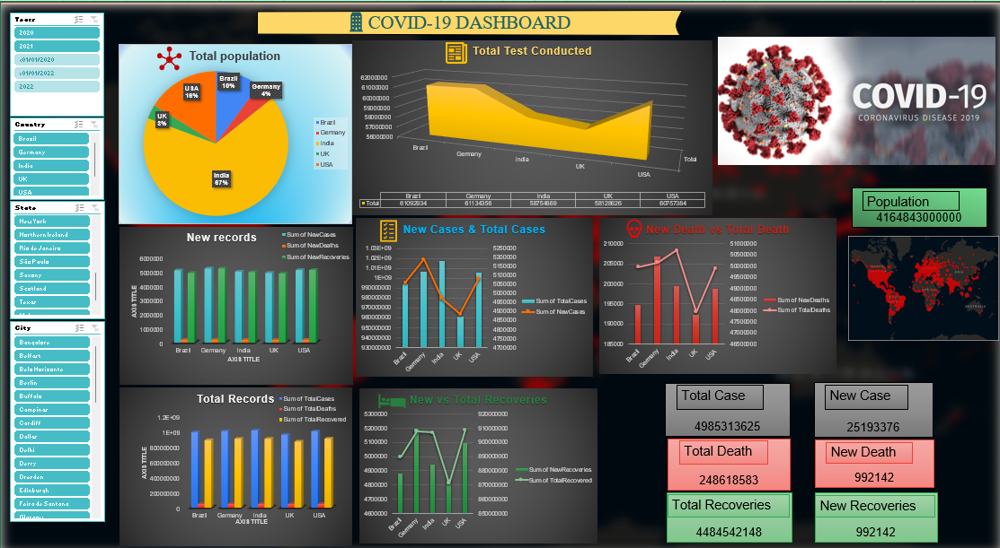

# COVID-19 Dashboard (Excel)

## Project Overview
This project presents a COVID-19 data dashboard built in Microsoft Excel to explore country-level indicators and compare reported totals through charts and filters.

## Dashboard Highlights
- Population summary
- Total tests conducted
- New cases and total cases
- New deaths and total deaths
- Recoveries and total recoveries
- Country and city comparisons
- Filters for year, country, state, and city

## Dashboard Preview

## Tools
- Microsoft Excel
- Excel charts and dashboard layout
- Interactive filters/slicers (as shown in the dashboard)

## Key Learning
This project helped me practice presenting data through summary metrics, trend/comparison charts, and interactive dashboard filters.

## Files
- `dashboard-screenshot.png` — preview of the completed dashboard
- Add the Excel workbook (`.xlsx`) and cite the dataset source if you want others to inspect the workbook and understand the underlying data.

## Data Note
Before publishing or using this dashboard for factual conclusions, verify the underlying dataset, reporting period, units, and metric definitions. The screenshot alone does not establish the accuracy or source of the displayed values.

## Notes
This repository currently contains the dashboard screenshot and project documentation. The source Excel workbook has not been included yet.
